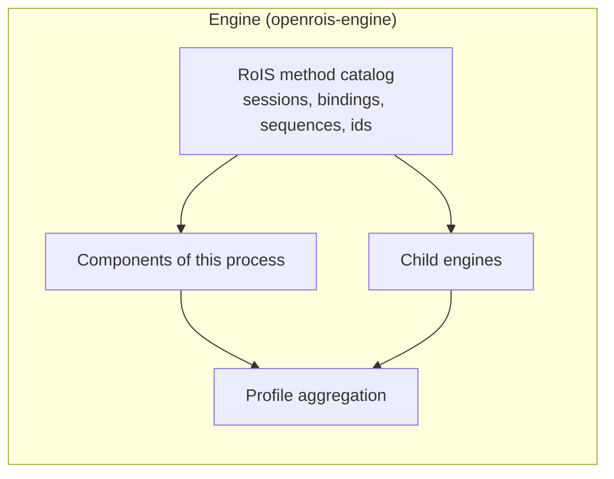

import ThemedImage from '@theme/ThemedImage';

# Architecture

OpenRoIS maps each concept of RoIS 2.0 onto a process or a class you can deploy. The
gateway realizes the main HRI Engine, each adapter realizes a sub HRI Engine, and HRI
Components are classes hosted by adapters.

<figure className="openrois-figure">
  <ThemedImage alt="OpenRoIS architecture: service applications, among them an AI agent through the MCP server, the gateway hosting the main HRI Engine, adapters hosting sub HRI Engines for physical robots, virtual avatars, and digital services, and their hosts." sources={{light: "/img/openrois-architecture.svg", dark: "/img/openrois-architecture-dark.svg"}} />
  <figcaption>Every middleware boundary uses WebSocket and JSON-RPC 2.0. Each adapter reaches its host through the transport that host requires, and media stays on a separate data plane.</figcaption>
</figure>

## From RoIS Concepts to OpenRoIS

| RoIS concept | OpenRoIS realization |
|--------------|----------------------|
| Service Application | Your application, built with the JavaScript, Python or Unity SDK |
| Main HRI Engine | The **gateway**: an `Engine` with child engines, behind a WebSocket server |
| Sub HRI Engine | An **adapter**: an `Engine` with local components, connected to the gateway |
| HRI Component | A class decorated with `@component`, hosted by an adapter |
| RoIS interfaces | JSON-RPC 2.0 methods in the `rois.*` namespaces |
| Implementation Layer | The physical robot, virtual avatar, or digital service behind an adapter, outside OpenRoIS |

## The Layers

### Service Applications

Applications use a client SDK to connect to the gateway over WebSocket. They discover
components from the engine profile, so the same application works with whatever is
connected behind the gateway. See [write a service application](../guides/service-application.md).

### The Gateway

The gateway is the process applications connect to. It hosts the main HRI Engine, which:

- **routes** each RoIS call to the adapter that owns the target component,
- **aggregates** the profiles of all connected adapters into one engine profile,
- **allocates** actuation components between applications through `bind` and `release`,
- **notifies** clients with `rois.system.profile_changed` when an adapter connects or
  leaves, so they refresh their view without polling.

The gateway does not authenticate connections yet. See
[deployment](deployment.md#security) for how to expose it safely.

### Adapters

An adapter is a standalone process that hosts a sub HRI Engine with the components of one
platform. It connects to the gateway, answers the gateway's discovery request with its
profile, and dispatches incoming calls to its components. Adapters reconnect with a
growing delay if the gateway restarts. See
[write components and an adapter](../guides/components-and-adapters.md).

### Components

A component is the translation layer between RoIS and one platform. It exposes RoIS
queries, commands, and events, and owns its connection to the platform: a ROS 2 node, a
gRPC client, or a cloud API client, created in `connect()` and closed in `disconnect()`.

## One Protocol at Every Hop

| Hop | Protocol | Transport |
|-----|----------|-----------|
| Application to gateway | The RoIS method catalog | WebSocket, JSON-RPC 2.0 |
| Gateway to adapter | The same RoIS method catalog, the requests a client sends | WebSocket, JSON-RPC 2.0 |
| Engine to component | The same RoIS operations and models, handled by `@command`, `@query` and `@event` | In process |
| Component to platform | Whatever the platform requires | ROS 2, gRPC, IPC, HTTP, and others |

On the gateway-to-adapter hop, the gateway is the adapter's only client: it connects first,
holds the bindings itself, and sends each command as its own one-command `execute`.

Only the first three are middleware boundaries. The last one belongs to the component, and
OpenRoIS deliberately takes no position on it. The mapping of the RoIS interfaces onto
JSON-RPC 2.0 is in the [wire protocol reference](../reference/wire-protocol.md).

## One Engine for Both Roles

RoIS distinguishes a **main HRI Engine**, the single entry point for applications, from
**sub HRI Engines**, which manage the components of individual units. OpenRoIS realizes
both roles with one class, `Engine`, from the `openrois-engine` package.

An `Engine` answers the RoIS method catalog for the sessions connected to it, and reaches
two kinds of component, either of which can be populated:

| Components | Reached with | Typically populated in |
|------------|--------------|------------------------|
| Components of its own process | The RoIS operations and models, as calls in process | Adapters (sub HRI Engines) |
| Components of its child engines | The RoIS method catalog over WebSocket, the requests a client sends | The gateway (main HRI Engine) |

It also holds the sessions, the bindings made with `bind` and `release`, the command
sequences and the command ids, and aggregates the profiles of its own components and its
child engines into a single HRI Engine profile.



When a call arrives, the engine selects the component and checks the call against its
profile. A component of its own process is called directly. A reference such as
`robot_1/navigation` is passed on to the child engine `robot_1`, with the same RoIS
operation.

The gateway and an adapter are therefore not two kinds of engine. They are two
compositions of the same class:

| Process | Composition |
|---------|-------------|
| Gateway | `Engine` + `WsServer`, accepting clients and adapters on one port |
| Adapter | `Engine` + its components + `WsClient`, connecting to the gateway |

```python title="gateway.py"
import asyncio

from openrois.engine import Engine, WsServer


async def main() -> None:
    engine = Engine("gateway")
    server = WsServer(engine)
    await engine.start()
    await server.start("127.0.0.1", 8765)
    try:
        await asyncio.Event().wait()
    finally:
        await server.stop()
        await engine.stop()


asyncio.run(main())
```

```python title="adapter.py"
from openrois.engine import Engine, WsClient

engine = Engine("robot_1")
engine.add_component("navigation", Navigation("http://192.168.0.10:8080"))
WsClient(engine, "ws://gateway.example.org:8765").run()
```

The standalone gateway process, `openrois-gateway`, runs exactly this composition with
configuration and signal handling, and adapters read their settings from `adapter.yaml`.

One engine class gives the logic that turns RoIS calls into component calls one
implementation, one set of tests, and one behavior, in the gateway and in every adapter.
Nothing in the design limits the depth of the hierarchy: a child engine can itself have
child engines. Current deployments use one gateway and one level of adapters.

### Bindings

The engine an application calls holds its bindings: only the session that bound an
actuation component may command it. The gateway is the only client of each adapter, so
the adapter skips the check the gateway already made, consistent with RoIS, which
consolidates resource ownership in the HRI Engine.

### Discovery

When an adapter connects to the gateway on the `/adapter` path, the gateway connects to it
with `rois.system.connect`, reads its profile with `rois.system.get_profile`, adds it as a
child engine, and broadcasts `rois.system.profile_changed` to connected applications. When
the adapter disconnects, its components and any bindings on them are removed, and
applications are notified again.

## Design Principles

RoIS deliberately leaves transport and implementation open. OpenRoIS fills these gaps with
explicit choices.

- **Paradigm neutrality.** ROS 2, DDS, gRPC, and game engines stay out of the engine and
  the client SDKs. All platform-specific code lives in adapters and their components, so
  support for a new kind of platform is an additional adapter, never a change to the core.
- **Specification traceability.** Every external interface and data type traces back to
  the normative machine-readable files of RoIS 2.0: the IDL files, the XML component
  profiles, and the `XML-Profiles.xsd` schema. Where those files disagree with each other,
  the XML component profile wins, and the
  [divergence is documented](https://github.com/openrois/openrois/blob/dev/docs/rois-reference.md#16-known-normative-divergences).
- **One source of truth for types.** The types that cross these boundaries are authored
  once as Python models and generated into TypeScript and C#, so the gateway, the adapters,
  and the SDKs cannot drift apart. See [how the types are generated](../project/type-generation.md).
- **Client consistency.** An application discovers what is available from the engine
  profile instead of hardcoding component names, so it keeps working when the platforms
  behind the gateway change.
- **Symbolic data only.** Messages carry symbolic results such as a count of detected
  people or a reached target, never image buffers or audio frames. Media stays on a
  [separate data plane](deployment.md#media).
- **Package management is not engine logic.** The engine routes calls, aggregates
  profiles, and tracks reservations. Loading components is the adapter's job, which keeps
  the engine small and testable in isolation.

## Further Reading

- [Deployment](deployment.md), from one laptop to the internet
- [RoIS in brief](rois-overview.md), the standard behind these roles
