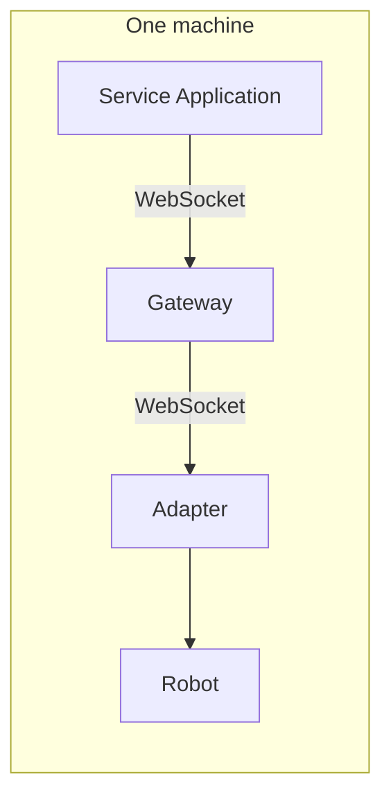
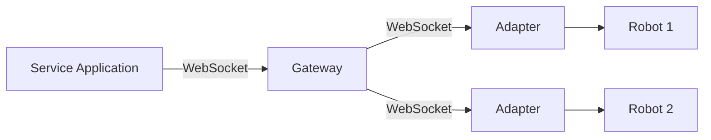
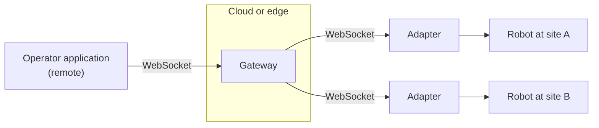
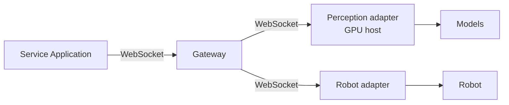

# Deployment

The control plane is uniform, so deployments of very different scales differ mainly in
**where the processes run**. The application, the gateway, and the adapters are the same
software in every case.

## Topologies

### Single Host

Everything runs on one machine: the application, the gateway, and the adapter. This is the
development setup, and it also suits a robot whose onboard computer runs the whole stack.



### Local Network

A gateway on the network serves several robots, each with its own adapter, and presents
one aggregated profile to the application.



### Across the Internet

The operator application, the gateway, and each robot may be in three different places, as
in teleoperation. WebSocket connections are outbound from the adapters, so robots behind a
firewall can join a gateway elsewhere. The gateway serves plain WebSocket, so a reverse
proxy in front of it terminates TLS ([security](#security)).



### Remote Compute

Components that need more compute than a robot carries, such as speech recognition or
large perception models, run in a separate adapter next to the compute, or as local
components of the gateway. The application cannot tell the difference: `search` returns
every component, and `bind` and `execute` behave identically wherever the component runs.



### Robots and Virtual Avatars Together

Nothing in the gateway or the SDKs is specific to physical robots. A virtual avatar
rendered in a game engine gets its own adapter, and an application addresses it with the
same calls it uses for a robot. A real Reachy Mini and a simulated one already run behind
one gateway this way. An adapter for a virtual avatar is on the
[roadmap](../project/roadmap.md).

## Security

:::info[Status]
The gateway does not authenticate or authorize connections, and serves plain WebSocket.
Authentication and authorization come in a later release
([roadmap](../project/roadmap.md)). Until then, use the gateway on a trusted network, or
behind a reverse proxy as below.
:::

The RoIS `connect` operation takes no credentials, because the specification assumes a
trusted network. OpenRoIS follows it: a deployment secures the gateway from the outside,
and the gateway makes that easy.

- It listens on `127.0.0.1` by default, and the Docker Compose quickstart publishes its
  port on loopback only. Bound to any other address, it logs a warning.
- Adapters connect on `/adapter`, and service applications on any other path, so a proxy
  can tell them apart.

### Remote Access Through a Reverse Proxy

Keep the gateway on loopback and let a reverse proxy terminate TLS in front of it. With
[Caddy](https://caddyserver.com/), which obtains certificates on its own and proxies
WebSocket connections without extra configuration:

```text
gateway.example.org {
	# Adapters run next to the gateway, so the internet may not register one.
	@adapter path /adapter
	respond @adapter 403

	reverse_proxy 127.0.0.1:8765
}
```

Clients then connect to `wss://gateway.example.org`. To decide who may connect, add
authentication at the proxy (client certificates, or `forward_auth` to your identity
provider) or use a VPN. Any proxy that forwards WebSocket upgrades works the same way.

### Reporting a Vulnerability

Please report security issues privately by email to **info@coarobo.com** with the subject
"OpenRoIS security report", rather than in public issues. See the
[security policy](https://github.com/openrois/openrois/blob/dev/SECURITY.md).

## Media

RoIS 2.0 standardizes stream **control** through the AudioStreaming and VideoStreaming
components, and leaves media encoding and transport to implementations. OpenRoIS keeps it
that way: it does not prescribe a media transport. A streaming component returns a
descriptor of its stream (its protocol, its endpoint, and what a client needs to connect),
and the engine routes it like any other result. The engine has no media dependencies and
opens no media ports, and media flows directly between the source and the consumer.

An adapter that already publishes RTSP, WHEP, a ROS 2 topic or a managed video service
returns that. For deployments with no media stack of their own, an optional WebRTC
integration is planned as the default. With it, the RoIS messages map onto WebRTC like
this:

| RoIS stream control | WebRTC counterpart |
|---------------------|--------------------|
| `set_parameter` for encoding and transport | SDP offer |
| `connect_stream` and its results | Peer connection established, SDP answer or media URL |
| `notify_stream_status` | Connection state changes |
| `suspend_stream`, `resume_stream` | Track disabled or enabled |
| `disconnect_stream` | Peer connection closed |

:::note[Status]
The engine serves the AudioStreaming and VideoStreaming profiles like any other component.
No streaming component ships yet, and media is [planned](../project/roadmap.md) as a
release of its own.
:::

Speech Synthesis is not a streaming component: the robot speaks text through its own
speaker, on a command. Audio Streaming and Video Streaming control live media that travels
between the robot and a remote operator.
