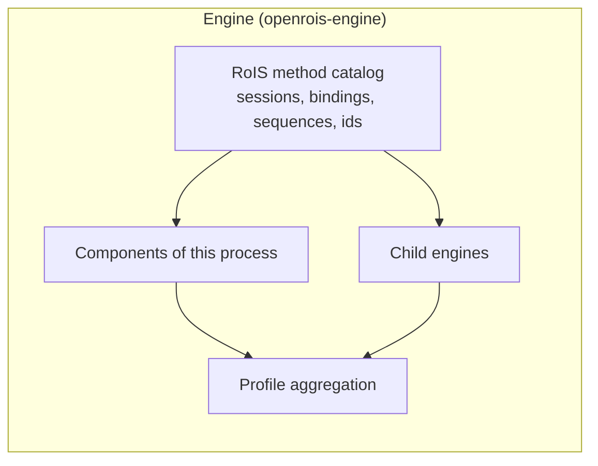

# The Recursive Engine

RoIS 2.0 distinguishes a **main HRI Engine**, the single entry point for applications, from
**sub HRI Engines**, which manage the components of individual units. OpenRoIS realizes
both roles with one class, `Engine`, from the `openrois-engine` package.

## One Class, Two Kinds of Component

An `Engine` answers the RoIS method catalog for the sessions connected to it, and reaches
two kinds of component, either of which can be populated:

| Components | Reached with | Typically populated in |
|------------|--------------|------------------------|
| Components of its own process | The RoIS operations and models, as calls in process | Adapters (sub HRI Engines) |
| Components of its child engines | The RoIS method catalog over WebSocket, the requests a client sends | The gateway (main HRI Engine) |

It also holds the sessions, the bindings made with `bind` and `release`, the command
sequences and the command ids, and aggregates the profiles of its own components and its
child engines into a single HRI Engine profile.



When a call arrives, the engine selects the component and checks the call against its
profile. A component of its own process is called directly. A reference such as
`robot_1/navigation` is passed on to the child engine `robot_1`, with the same RoIS
operation.

## Processes Are Compositions

The gateway and an adapter are not two different kinds of engine. They are two
compositions of the same class:

| Process | Composition |
|---------|-------------|
| Gateway | `Engine` + `WsServer`, accepting clients and adapters on one port |
| Adapter | `Engine` + its components + `WsClient`, connecting to the gateway |

```python title="gateway.py"
import asyncio

from openrois.engine import Engine, WsServer


async def main() -> None:
    engine = Engine("gateway")
    server = WsServer(engine)
    await engine.start()
    await server.start("127.0.0.1", 8765)
    try:
        await asyncio.Event().wait()
    finally:
        await server.stop()
        await engine.stop()


asyncio.run(main())
```

```python title="adapter.py"
from openrois.engine import Engine, WsClient

engine = Engine("robot_1")
engine.add_component("navigation", Navigation("http://192.168.0.10:8080"))
WsClient(engine, "ws://gateway.example.org:8765").run()
```

The standalone gateway process, `openrois-gateway`, runs exactly this composition with
configuration and signal handling, and adapters read their settings from `adapter.yaml`
(see [write components and adapters](../guides/components-and-adapters.md)).

The engine an application calls holds its bindings: only the session that bound an
actuation component may command it. The gateway is the only client of each adapter, so
the adapter skips the check the gateway already made, consistent with RoIS, which
consolidates resource ownership in the HRI Engine.

## Why It Matters

A recursive engine gives the dispatch logic that turns RoIS calls into component calls
one implementation, one set of tests, and one behavior, in the gateway and in every
adapter. It also matches the specification literally, since a sub HRI Engine is an engine,
not a passive backend.

Nothing in the design limits the depth of the hierarchy: a child engine can itself have
child engines. Current deployments use one gateway and one level of adapters.

## Discovery

When an adapter connects to the gateway on the `/adapter` path, the gateway connects to it
with `rois.system.connect`, reads its profile with `rois.system.get_profile`, adds it as a
child engine, and broadcasts `rois.system.profile_changed` to connected applications. When
the adapter disconnects, its components and any bindings on them are removed, and
applications are notified again.
