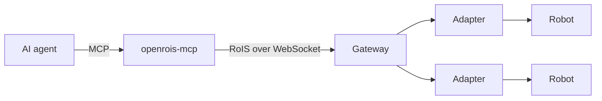

# Drive Robots with an AI Agent

`openrois-mcp` is a [Model Context Protocol](https://modelcontextprotocol.io/) server that
gives an AI agent the components behind an OpenRoIS gateway. The agent finds the
components, reads their profiles, reads state, follows events and, when you allow it, runs
commands. It needs no knowledge of any robot's own API, because the gateway already
presents every robot through the RoIS interfaces.



The server is an ordinary service application, built on the
[Python SDK](../reference/sdks.md). To the gateway, an agent is one more RoIS session.

## Install

```bash
pip install openrois-mcp
```

The server needs Python 3.12 or later and a running gateway. The
[quick start](../getting-started/quickstart.md) starts one with simulated components.

## Connect an Agent

Any MCP client can start the server over stdio. With Claude Code:

```bash
claude mcp add openrois -- openrois-mcp --gateway-url ws://127.0.0.1:8765 --allow-actions
```

With a client that reads a JSON configuration, such as Claude Desktop:

```json
{
  "mcpServers": {
    "openrois": {
      "command": "openrois-mcp",
      "args": ["--gateway-url", "ws://127.0.0.1:8765", "--allow-actions"]
    }
  }
}
```

Leave out `--allow-actions` to let the agent look but not act. Then ask the agent what it
can see, for example "which robots are connected, and what can they do?".

## What the Agent Can Do

| Tool | What it does |
|------|--------------|
| `list_components`, `describe_component` | Find components and read their commands, queries, events and parameters |
| `query`, `get_parameters` | Read state |
| `subscribe`, `unsubscribe`, `get_events`, `wait_for_event` | Follow events, and wait for one |
| `bind`, `release` | Reserve and free a component |
| `set_parameters`, `run_commands` | Configure components, and run commands in order or in parallel groups |
| `command_status`, `get_error_detail` | See how commands ended, and why one failed |

`bind`, `release`, `set_parameters` and `run_commands` exist only with `--allow-actions`.
The [server README](https://github.com/openrois/openrois/blob/dev/services/mcp/README.md)
documents every tool, its arguments and its replies.

## Safety

The gateway does not authenticate connections yet, and an agent with actions allowed can
move a physical robot. The server limits what an agent can do:

- **Read-only by default.** Without `--allow-actions`, the agent can only look.
- **An allow list.** `--allow 'reachy_real/%'`, repeatable, limits the components an
  agent can bind, configure and command. Discovery still shows every component.
- **Annotations.** The tools that act are marked destructive, so an MCP client can ask
  you before it runs them.
- **A clean exit.** When the agent closes the server, it stops what the session started,
  ends its subscriptions, releases every bind and disconnects.

## Several Agents

The engine tells clients apart by their RoIS session, and gives an actuation component to
one session at a time. Each server process holds one session, so two agents that each
start their own server take turns on a robot through `bind`. An agent that finds a
component busy learns that it is busy, not who holds it, and is told to ask you before it
waits.

An agent and an application can share a gateway in the same way. The
[Inspector](inspector.md) shows what the agent holds while it works.
